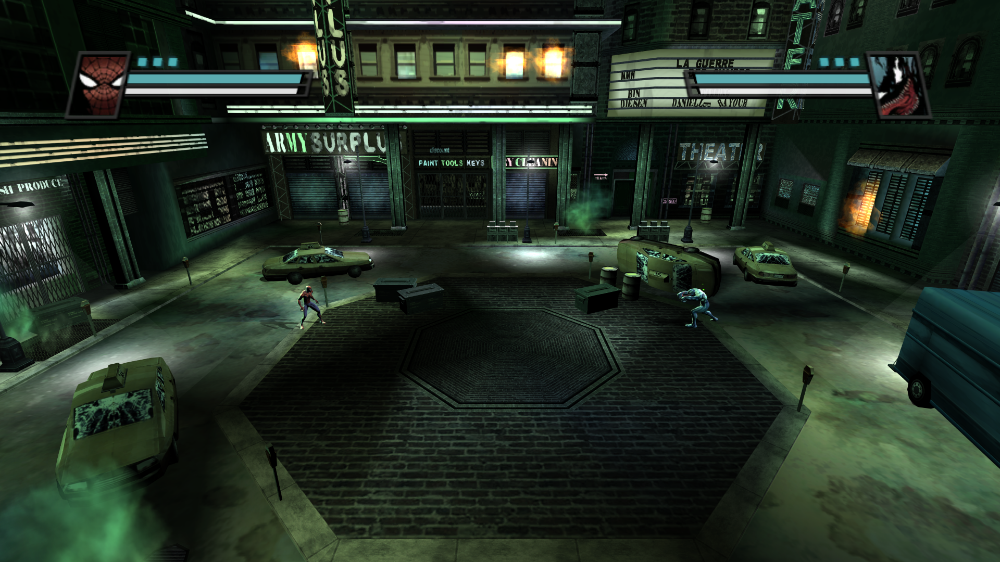
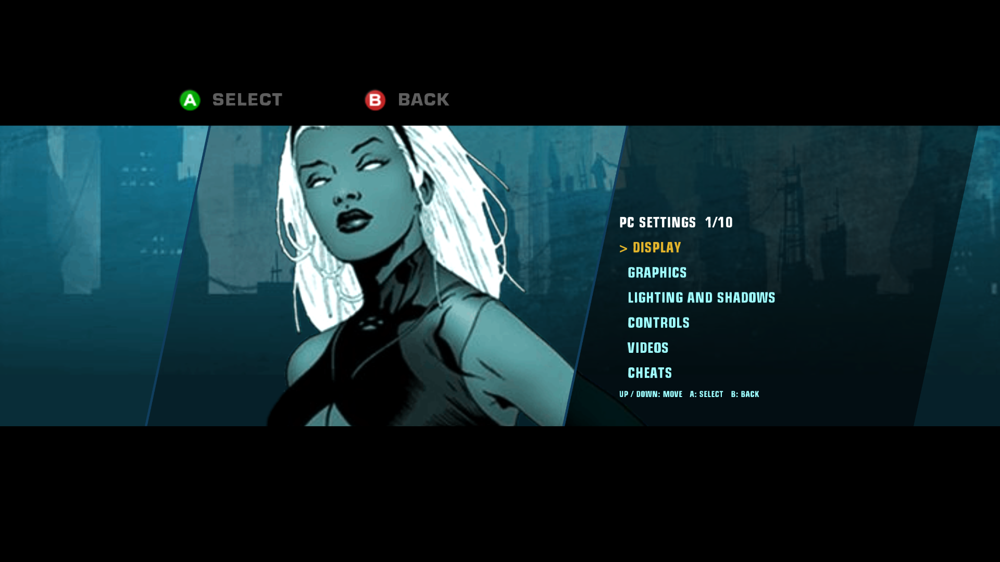
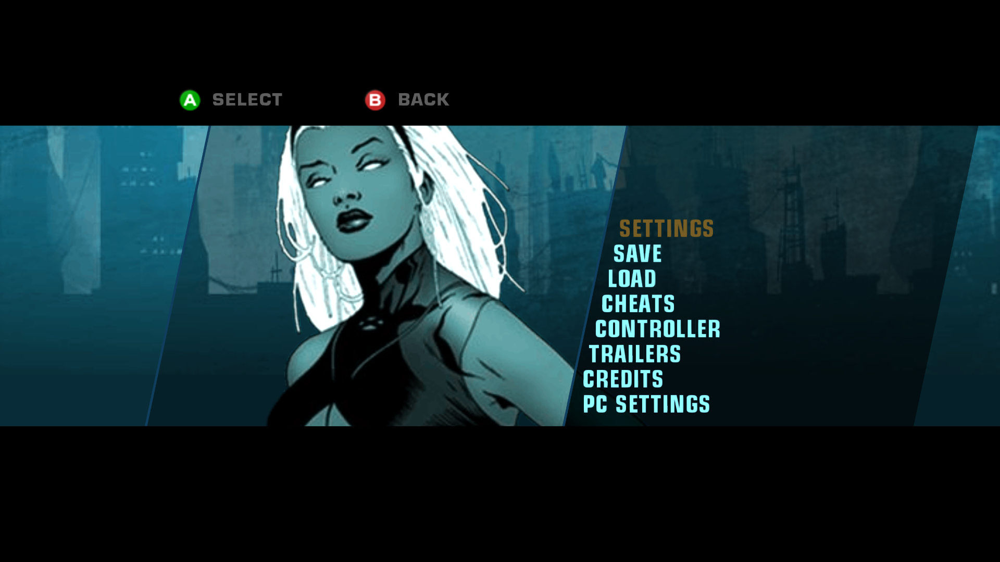
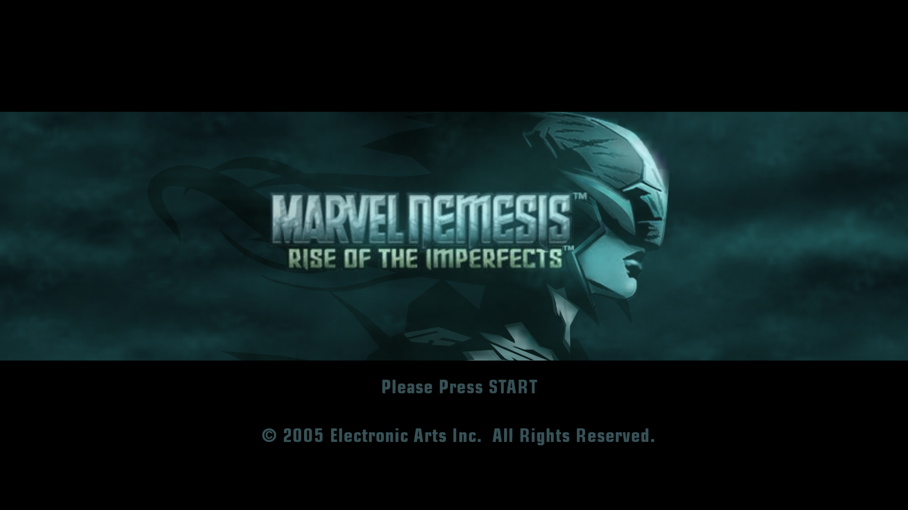
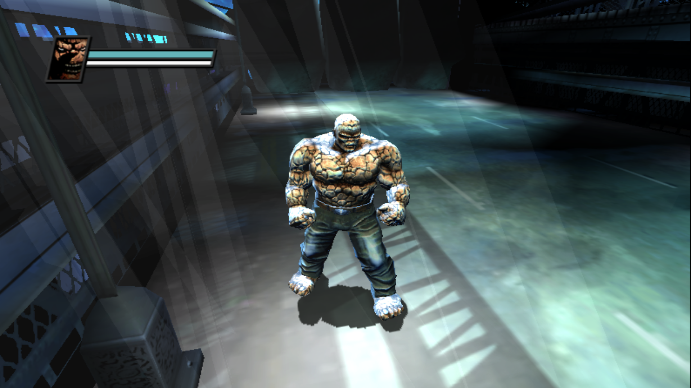
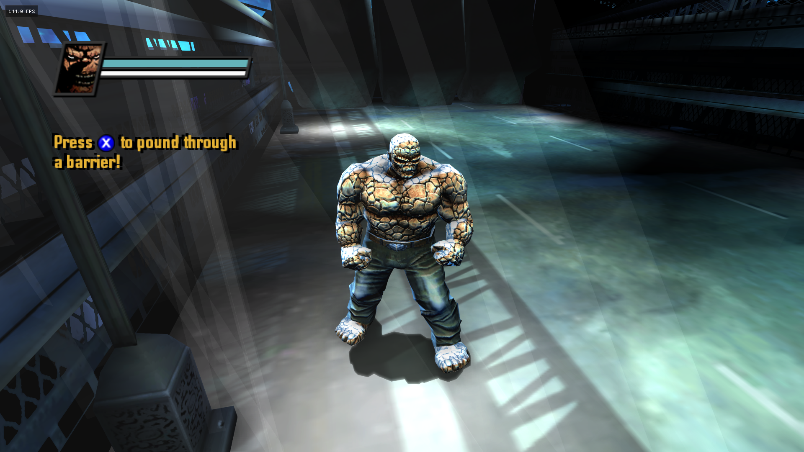

# Screenshots, video and comparisons

I captured these screenshots to document the PC port. They are gameplay/menu captures, not extracted textures, models or other usable game resources. Original imagery remains the property of its respective rights holders; the software MIT license does not grant rights to that artwork.

## Gameplay

## Native menus

## Original presentation

## Graphics comparisons

I identified the 11:48:34 capture as **before**; the companion 11:46:51 capture is presented as **after** in the supplied pair. Both files are copied without edits. This is not labeled as original-console footage versus PC: the capture origin and per-option settings have not been established as a console comparison.

### Before — baseline capture

### After — enhanced capture

The captures show different moments, including animation/HUD differences. Exact resolution scale, antialiasing and other per-option settings were not supplied for this pair. The images demonstrate the reported overall visual difference, not a controlled attribution to one setting. Capped screenshots are not performance benchmarks.

## Video walkthrough

**Available now:** [Watch the PC port showcase on YouTube](https://youtu.be/LgDM9how-TY), covering menus and gameplay.

Future comparison captures should identify resolution/render scale, antialiasing, AO, shadow resolution/softness and mods. The goal is to show the port's changes without implying that original assets have been remastered or that an unmeasured feature has no performance cost.
